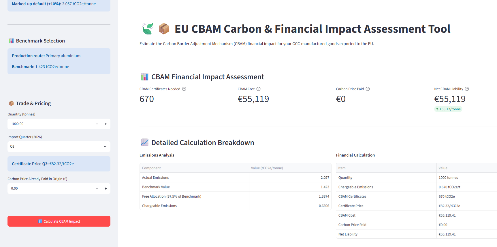

# EU CBAM Carbon & Financial Impact Assessment Tool

A Streamlit application that estimates the financial impact of the EU Carbon Border Adjustment Mechanism (CBAM) on goods manufactured in GCC countries and exported to the European Union.

**Live application:** https://cbam-calculator-gcc.streamlit.app

## Overview

The EU CBAM applies a carbon price to selected carbon-intensive goods imported into the EU. Exporters need to understand the embedded emissions of their products and what CBAM could cost them.

This tool combines country-specific default emissions, EU CBAM benchmarks, production routes, shipment quantity and certificate prices to estimate potential CBAM exposure for 2026.

## Features

- **GCC coverage:** Bahrain, Kuwait, Oman, Qatar, Saudi Arabia and the United Arab Emirates.
- **Product selection** by CN code, with the production route shown for each product.
- **Default emissions** for the selected country. Where a country has no value, the "Other Countries and Territories" default is used, as set out in Regulation 2025/2621.
- **Benchmark lookup** by CN code and production route, following Regulation 2025/2620.
- **Results:** certificates required, CBAM cost, carbon price already paid abroad, and net liability, with a calculation breakdown.
- **Cost by import quarter** for the 2026 certificate prices.

## Method

For a product with default emissions:
Free allocation = CBAM benchmark × CBAM factor (0.975 for 2026) × CSCF (1.0 for 2026, provisional)
Chargeable = (Default emissions × (1 + mark-up) − Free allocation) × Quantity (tCO₂e)
CBAM cost = Chargeable × Certificate price
Net liability = CBAM cost − Carbon price already paid abroad

The mark-up is 10% for most sectors in 2026 and 1% for fertilisers, as set out in Regulation 2025/2621.

## Data

| File | Contents |
|---|---|
| `data/gcc_embedded_emissions_data.csv` | Default emissions by country, CN code and production route |
| `data/cbam_benchmarks.csv` | CBAM benchmarks (Column B) by CN code, production route and year |

Sources:
- Regulation (EU) 2023/956 establishing the CBAM
- Commission Implementing Regulation (EU) 2025/2620 (benchmarks)
- Commission Implementing Regulation (EU) 2025/2621 (default values)
- [European Commission: CBAM legislation and guidance](https://taxation-customs.ec.europa.eu/carbon-border-adjustment-mechanism/cbam-legislation-and-guidance_en)

## Run Locally

```bash
git clone https://github.com/sandarahashraf/cbam-calculator.git
cd cbam-calculator
python -m venv venv
venv\Scripts\activate
pip install -r requirements.txt
streamlit run app.py
```
## Screenshot


## Limitations

- Covers six GCC countries and 2026 only.
- Uses default emissions. Actual verified emissions are not supported yet.
- Actual verified emissions need the Column A benchmarks, which are not included.
- No result is shown where no benchmark is available for a product and route.
- The CBAM factor, CSCF, certificate prices, benchmarks and default values are provisional or may change.
- Results are estimates for guidance only. They are not a CBAM declaration or legal advice.

## Future Improvements

- Verified actual emissions, with Column A benchmarks.
- 2027 and 2028 values, once published.
- Automatic updates of certificate prices.
- Exportable assessment reports.

## Author

**Sandarah Ashraf**, Environmental Engineering | Sustainability | Carbon Accounting | Data Analytics

Portfolio project: EU CBAM Carbon & Financial Impact Assessment Tool